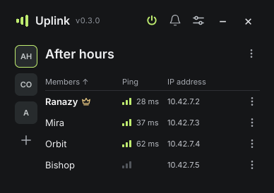

#  Uplink

**A private LAN for you and your friends, wherever you play.**

Run Uplink on Windows and host the network on your own VPS. Send an invitation, open your game, and find each other on the LAN or connect using the virtual IP shown in Uplink. One Windows adapter can connect to several networks at once, even when they live on different servers.

[Download for Windows](https://github.com/VoyagerVPN/Uplink/releases/latest) · [Server guide](server/README.md) · [Русский](README.ru.md)



## Join a friend

1. Install Uplink on Windows x64, then open it from your regular Windows account.
2. Click **+**, paste an invitation, and join. If your friend gave you a password, enter the server address, network name, and password instead.
3. Open your game. Use its LAN list if it supports discovery, or copy your friend's IP from Uplink for a direct connection.

Your saved networks are on the left. Select one to see its members, ping, and IP addresses. Closing the window leaves Uplink in the tray.

## Host your own network

Open **+ → Create a network on my VPS**. Give the network a name and enter the SSH access details from your hosting provider. Uplink sets up the server and gives you an invitation to share.

Use an x64 VPS with Debian 12 or Ubuntu 24.04 and administrator access over SSH. The [server guide](server/README.md) covers ports and hosting providers with an HTTPS proxy.

## Update your server

In Uplink 0.3.0, open your network's **⋮ → Update server** as its owner. Enter the VPS SSH details and confirm. All networks on that VPS briefly disconnect while Uplink backs up their data, installs the server update, and checks the services. If the check fails, Uplink restores the previous version and tells you what happened.

The network menu shows the server version. Owners also see **Server update** in the notification bell when their VPS has an update available. Use **Copy update log** if you need help with the result.

## Build from source

On Windows x64, install Visual Studio Build Tools with MSVC and the Windows SDK. From the project directory, run:

```powershell
.\dev.ps1 test
.\installer\build.ps1
```

The package is at `.cache/packages/Uplink-Setup.exe`. See the [release process](release/README.md) and the [project checklist](UX-CHECKLIST.md) if you're contributing.

The UI uses [Slint](https://slint.dev/terms-and-conditions) and [Inter](assets/fonts/Inter-LICENSE.txt).
