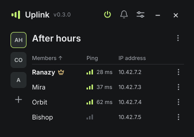

#  Uplink

**Локальная сеть для друзей, даже если вы играете из разных городов.**

Uplink работает на Windows, а сеть размещается на вашем VPS. Отправьте приглашение, откройте игру и найдите друзей в списке локальных игр или подключитесь по их IP из Uplink. Через один адаптер Windows можно одновременно быть в нескольких сетях на разных серверах.

[Скачать для Windows](https://github.com/VoyagerVPN/Uplink/releases/latest) · [Руководство по серверу на английском](server/README.md) · [English](README.md)



## Подключиться к другу

1. Установите Uplink для Windows x64 и откройте его под своей обычной учётной записью.
2. Нажмите **+**, вставьте приглашение и подключитесь. Если друг дал пароль, введите адрес сервера, имя сети и пароль.
3. Откройте игру. Если в игре есть поиск по локальной сети, проверьте список. Для прямого подключения скопируйте IP друга в Uplink.

Сохранённые сети находятся слева. Выберите сеть, чтобы увидеть участников, пинг и IP. После закрытия окна Uplink продолжает работать в трее.

## Создать свою сеть

Откройте **+ → Создать сеть на своём VPS**. Введите имя сети и данные SSH из панели хостинга. Uplink настроит сервер и выдаст приглашение для друзей.

Подойдёт VPS x64 с Debian 12 или Ubuntu 24.04 и правами администратора по SSH. Требования к портам и варианты с HTTPS-прокси описаны в [руководстве по серверу](server/README.md).

## Обновить сервер

В Uplink 0.3.0 откройте меню своей сети **⋮ → Обновить сервер**. Введите данные SSH от VPS и подтвердите обновление. Все сети на этом VPS ненадолго отключатся. Uplink сохранит резервную копию, установит обновление и проверит запуск служб. Если проверка завершится ошибкой, приложение восстановит прежнюю версию и покажет результат.

Версия сервера видна в меню сети. Если для VPS доступно обновление, его владелец увидит уведомление под колокольчиком. Если нужна помощь, нажмите **Скопировать журнал обновления**.

## Собрать из исходников

На Windows x64 понадобятся Visual Studio Build Tools с MSVC и Windows SDK. Выполните в папке проекта:

```powershell
.\dev.ps1 test
.\installer\build.ps1
```

Установщик появится в `.cache/packages/Uplink-Setup.exe`. Для работы над проектом есть [порядок выпуска](release/README.md) и [чеклист](UX-CHECKLIST.md).

Интерфейс использует [Slint](https://slint.dev/terms-and-conditions) и шрифт [Inter](assets/fonts/Inter-LICENSE.txt).
